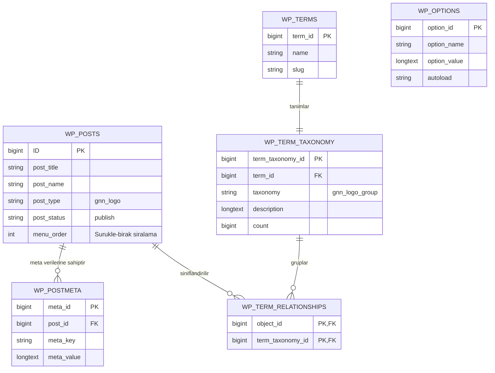

# Veri Sözlüğü ve Kalıcılık Belirtimi

<!-- Verified from: gnn-logos/includes/class-gnn-logos-cpt.php -->
<!-- Verified from: gnn-logos/inc/updater.php -->
<!-- Verified from: gnn-logos/uninstall.php -->

## 1. Varlık İlişkileri Genel Bakışı (ER Şeması)

GNN Logos, özel SQL tablosu oluşturmadan tamamen WordPress çekirdek ilişkisel tablolarını kullanır:

---

## 2. Temel Varlıklar

### 2.1 Özel Yazı Türü (CPT): `gnn_logo`
- **Depolama:** `wp_posts` (`post_type = 'gnn_logo'`)
- **Sıralama (`menu_order`):** Yönetim listesinde varsayılan sıralama `menu_order ASC` olarak çalışır ve `wp_ajax_gnn_logos_reorder` ile sürükle-bırak olarak doğrudan güncellenir.

### 2.2 Taksonomi: `gnn_logo_group`
- **Depolama:** `wp_terms`, `wp_term_taxonomy`, `wp_term_relationships`
- **Tür:** Hiyerarşik kategori; CPT yönetim tablosunda doğrudan açılır filtre (`restrict_manage_posts`) ve Toplu Logo Yükleme çubuğunda hedef grup seçici olarak sunulur.

---

## 3. Postmeta Anahtarları

| Meta Anahtarı (`meta_key`) | Veri Türü | Sanitizasyon Fonksiyonu | Amaç ve Varsayılan Değer |
|---|---|---|---|
| `_gnn_logo_id` | Tamsayı (`bigint`) | `absint()` | WordPress medya eki ID'si (`attachment`) |
| `_gnn_cert_codes` | String Dizisi | `sanitize_text_field(wp_unslash())` | Çoklu standart rozet dizisi (örn: `['TS EN 12201-2', 'TS EN ISO 1452-2']`) |
| `_gnn_cert_code` | Metin (`varchar`) | `sanitize_textarea_field(wp_unslash())` | Geriye uyumlu tekli/çok satırlı standart metni |
| `_gnn_description` | Metin (`text`) | `sanitize_text_field(wp_unslash())` | Alt açıklama / akreditasyon kurumu metni |
| `_gnn_link_url` | URL | `esc_url_raw(wp_unslash())` | Tıklama veya Lightbox dış belge/PDF bağlantısı |
| `_gnn_link_target` | Enum | `in_array(..., ['_self', '_blank'], true)` | Bağlantı hedefi (varsayılan `'_blank'`) |
| `_gnn_aspect_ratio` | Enum | `in_array(..., ['auto', '16:9', '4:3', '1:1', '3:2', '2:1'], true)` | Öğeye özel en-boy oranı geçersiz kılma (varsayılan `'auto'`) |

---

## 4. Önbellekleme ve Transient Sözlüğü

| Transient Anahtarı | Yaşam Süresi (TTL) | Temizleme Tetikleyicisi | Saklanan Yapı |
|---|---|---|---|
| `gnn_logos_github_update_check` | `43200s` (12 saat pozitif) / `300s` (5 dk negatif) | `load-update-core.php`, manuel kontrol veya `uninstall.php` | Release nesnesi (`version`, `download_url`, `changelog`, `published_at`) veya `(object) ['failed' => true]` |
| `_site_transient_update_plugins` | WP Çekirdeği yönetir | `pre_set_site_transient_update_plugins`, `uninstall.php` | Standart WP güncelleme nesnesi (`response` veya `no_update`) |

---

## 5. Fiziksel Depolama Varlıkları

| Varlık Türü | Depolama Konumu | Yönetim Arayüzü |
|---|---|---|
| **Logo Görselleri** | `/wp-content/uploads/YYYY/MM/` | Tekli Ortam Seçici veya Çoklu Toplu Logo Yükleyici (`wp.media`) |
| **Gutenberg Blok Tanımı** | `/wp-content/plugins/gnn-logos/blocks/showcase/` | `block.json` + zero-build `editor.js` |
| **Sürüm Arşivi** | `gnn-logos-2.0.0.zip` | GitHub Releases (`.github/workflows/release.yml`) |
