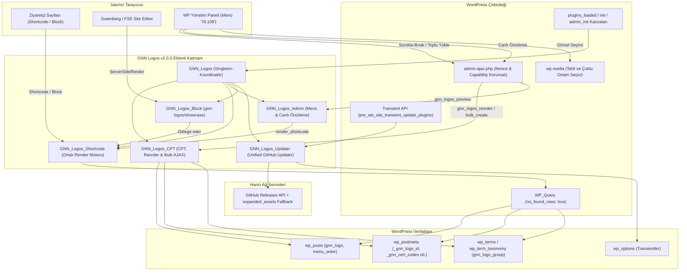

# Sistem Mimarisi ve Topoloji Belirtimi

<!-- Verified from: gnn-logos/gnn-logos.php#L1-L165 -->
<!-- Verified from: .specs/boundary-conditions.md#L1-L98 -->

## 1. Dizin Topolojisi

```text
gnn-logos/
├── gnn-logos.php                      # [Çekirdek] Ana giriş noktası, singleton başlatıcı, eylem bağlantıları
├── readme.txt                         # [Metadata] WordPress.org depo bilgileri ve değişiklik günlüğü
├── uninstall.php                      # [Yaşam Döngüsü] Yazı, meta, terim ve transient verilerini temizleyen kaldırıcı
├── languages/
│   └── gnn-logos.pot                  # [Yerelleştirme] 177 dizgilik POT çeviri şablonu
├── inc/
│   └── updater.php                    # [Güncelleyici] Unified GNN GitHub Releases API + HTML fallback güncelleyici
├── includes/
│   ├── class-gnn-logos-cpt.php        # [Model/Admin] 'gnn_logo' CPT, Taksonomi, Meta Kutuları, Reorder & Bulk AJAX
│   ├── class-gnn-logos-shortcode.php  # [Motor/Görünüm] Ortak [gnn_logos] & Gutenberg blok render motoru
│   ├── class-gnn-logos-admin.php      # [Yönetim] '79.109' menüsü, Canlı Önizlemeli Shortcode Oluşturucu & Preview AJAX
│   └── class-gnn-logos-block.php      # [Blok] Native Gutenberg blok kaydı (apiVersion 3) ve render_callback
├── blocks/
│   └── showcase/
│       ├── block.json                 # [Şema] 30 nitelikli gnn-logos/showcase blok manifestosu
│       └── editor.js                  # [Editör] Zero-build InspectorControls (5 panel) + ServerSideRender
└── assets/
    ├── css/
    │   ├── gnn-logos-frontend.css     # [Görünüm] Tema tokenları, Glass, Marquee, Carousel, Lightbox (~23.6 KB)
    │   └── gnn-logos-admin.css        # [Yönetim] Sürüklenebilir tablo, Toplu Yükleme çubuğu, Canlı Önizleme (~11.5 KB)
    └── js/
        ├── gnn-logos-frontend.js      # [Görünüm] ResizeObserver Marquee, Carousel, Lightbox Vanilla JS (~17.7 KB)
        └── gnn-logos-admin.js         # [Yönetim] Sortable reorder, Bulk Media Uploader, Canlı Önizleme (~22.7 KB)
```

---

## 2. Bileşen Mimari Şeması



---

## 3. Bileşen Kütüğü

| Bileşen | Dosya Yolu | Temel Sorumluluk |
|---|---|---|
| `GNN_Logos` | `gnn-logos/gnn-logos.php` | Singleton ana koordinatör; aktivasyon, dil yükleme (`init` priority `1`) ve eklenti eylem bağlantıları |
| `GNN_Logos_CPT` | `gnn-logos/includes/class-gnn-logos-cpt.php` | `gnn_logo` CPT, `gnn_logo_group` taksonomisi, meta kutuları, kategori filtresi, sıralanabilir `Sıra` sütunu, `gnn_logos_reorder` ve `gnn_logos_bulk_create` AJAX uç noktaları |
| `GNN_Logos_Shortcode` | `gnn-logos/includes/class-gnn-logos-shortcode.php` | Shortcode, Gutenberg bloğu ve Canlı Önizleme tarafından ortak kullanılan tek HTML render motoru; varlıkları `init` priority `5`'te kaydeder |
| `GNN_Logos_Block` | `gnn-logos/includes/class-gnn-logos-block.php` | `blocks/showcase/block.json` kaydı, terim verilerini editöre aktarma (`gnnLogosBlockData`) ve `render_callback` |
| `GNN_Logos_Admin` | `gnn-logos/includes/class-gnn-logos-admin.php` | `'79.109'` doğrudan CPT menüsü, `jquery-ui-sortable` / canlı önizleme varlık yükleme ve `gnn_logos_preview` AJAX uç noktası |
| `GNN_Logos_Updater` | `gnn-logos/inc/updater.php` | Unified GNN GitHub Updater standardı; API + `expanded_assets` fallback, SSRF koruması, `upgrader_pre_install` durum yakalama ve kurulum sonrası yeniden etkinleştirme |

---

## 4. Veri Akışı ve Önyüz Motoru

1. **Ortak Render Hattı:** `[gnn_logos]`, `gnn-logos/showcase` ve `gnn_logos_preview` isteklerinin tamamı `GNN_Logos_Shortcode::render_shortcode()` üzerinden tek doğruluk kaynağı olarak işlenir.
2. **Sorgu ve Temizleme:** `WP_Query` içinde `no_found_rows => true` kullanılır; görseli, başlığı, rozeti ve açıklaması tamamen boş olan kayıtlar atlanır; CSS değerleri (`gap`, `aspect_ratio`, `logo_height`, `item_width`, `speed`) katı regex doğrulamasından geçer.
3. **Çok Gruplu Marquee:** Öğeler `.gnn-marquee-group` kapsayıcısına basılır; `gnn-logos-frontend.js` içindeki `ResizeObserver` konteyner genişliğini ölçüp 4K ekranlarda bile boşluk kalmayana dek `aria-hidden="true"` + `tabindex="-1"` grupları dinamik klonlar.
4. **Akıllı Karusel:** `goNext()` yalnızca `scrollLeft >= max - 5` olduğunda başa sarar; ulaşılamayan noktalar gizlenir; tüm öğeler ekrana sığıyorsa `.gnn-carousel-static` eklenir; `IntersectionObserver`, `visibilitychange`, `focusin` ve `touchstart` olayları autoplay zamanlayıcısını akıllıca duraklatır.
5. **Delegasyonlu Lightbox:** Tek bir `document` click dinleyicisi `.gnn-logo-item[data-gnn-lightbox="1"]` düğmelerini yakalar ve `innerHTML` kullanmadan saf DOM düğümleriyle erişilebilir modalı açar.
